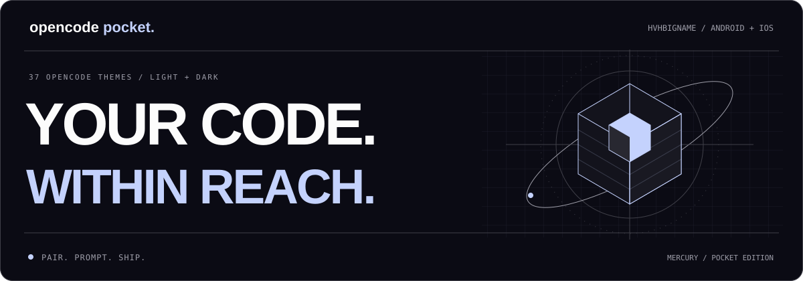
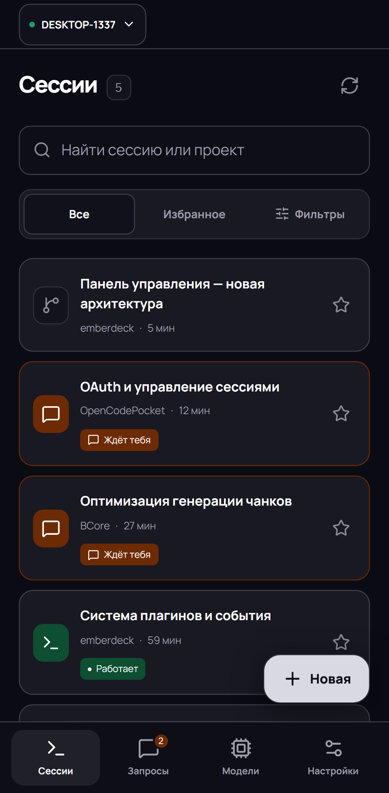
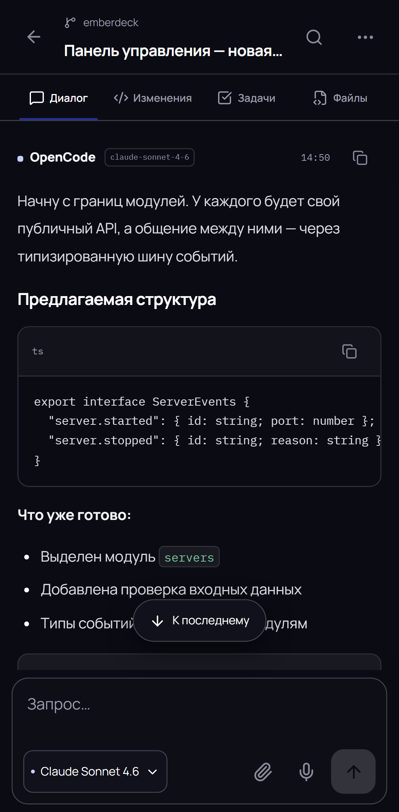
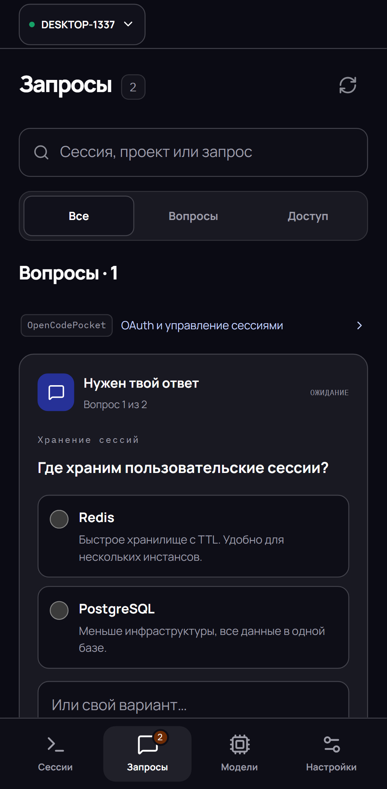
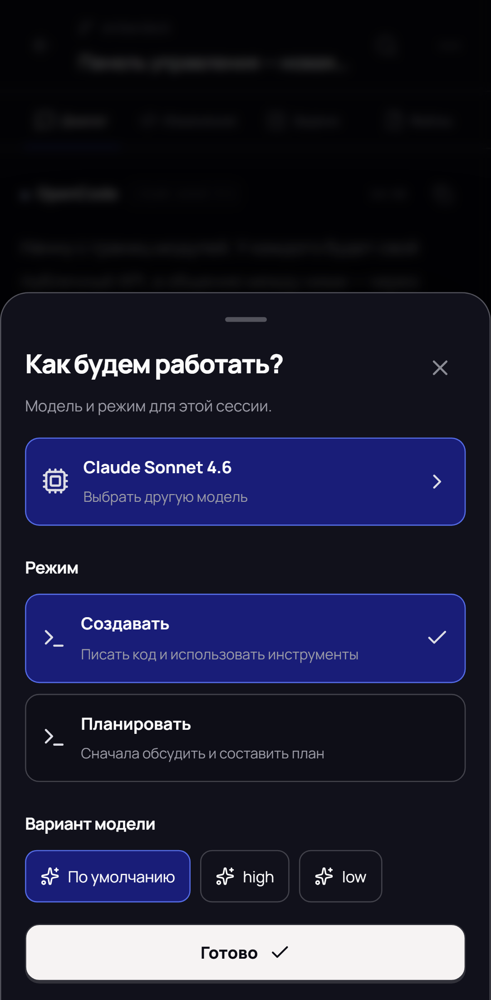
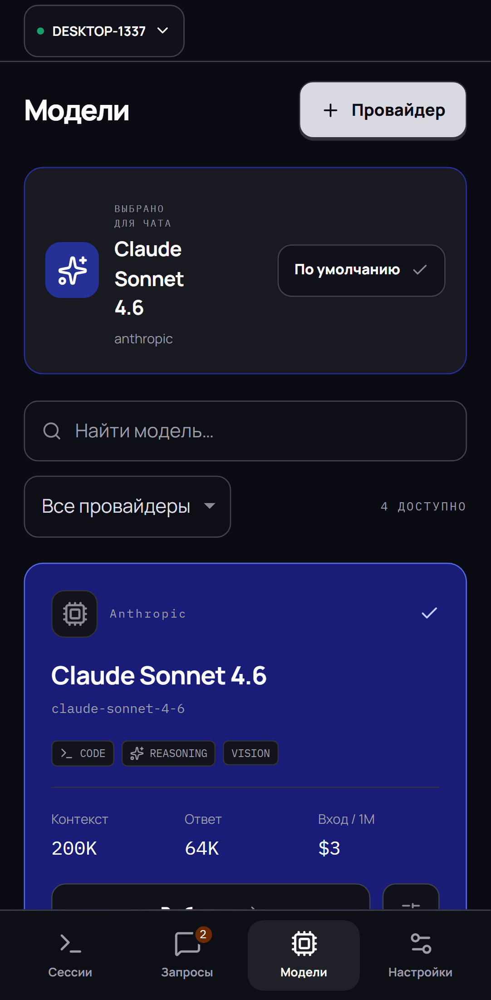
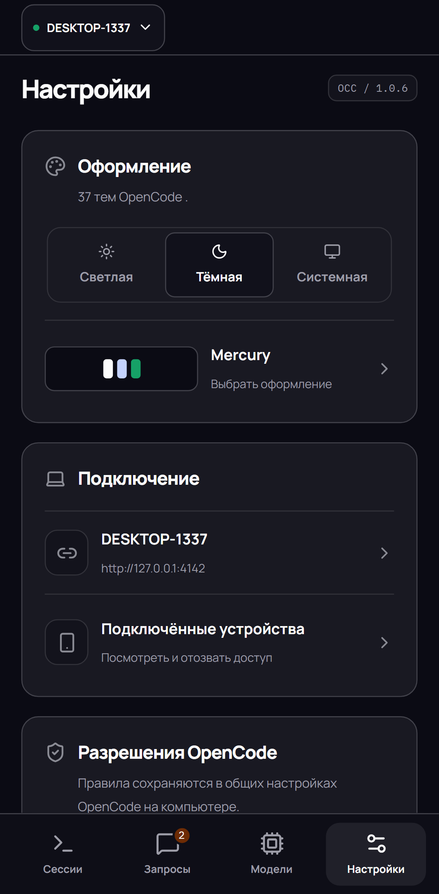
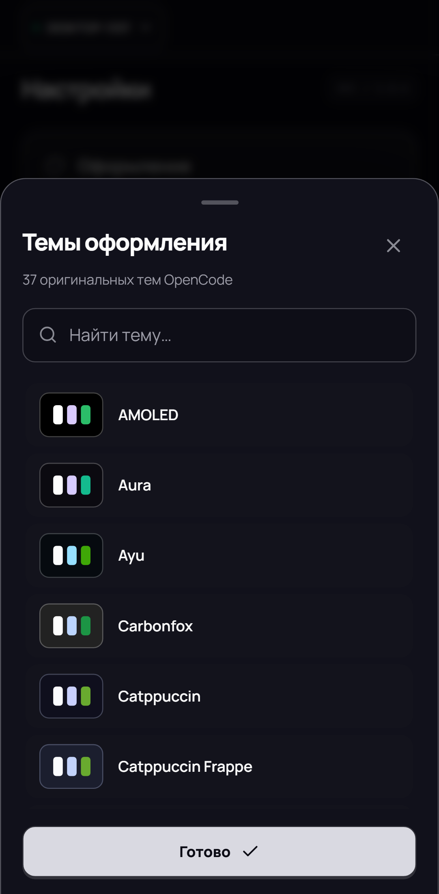
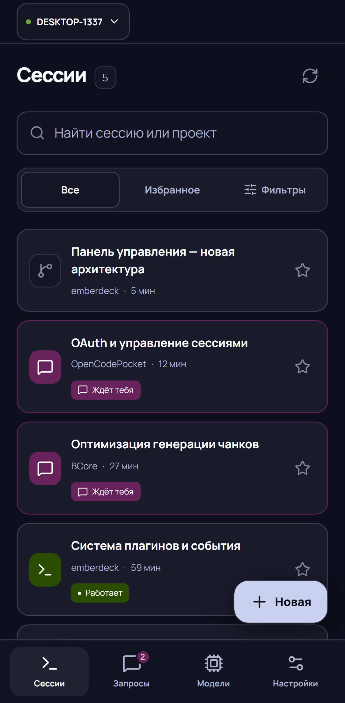
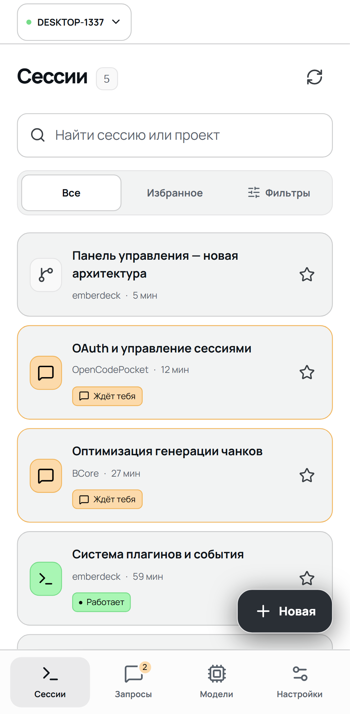

<p align="center"></p>

<p align="center">
  <a href="https://github.com/HVHBIGNAME/OpenCodePocket/releases/latest"><b>Скачать APK / IPA</b></a> &nbsp; / &nbsp;
  <a href="docs/connect.md">Подключение</a> &nbsp; / &nbsp;
  <a href="docs/build.md">Собрать самому</a> &nbsp; / &nbsp;
  <a href="docs/notifications.md">Уведомления</a>
</p>

# OpenCode Pocket / OCC

**Твой код. Всегда рядом.** Мобильный клиент [OpenCode](https://opencode.ai) для Android и iOS. Продолжай сессии с компьютера, отправляй промпты, отвечай на вопросы и управляй моделями — с телефона.

**37 оригинальных тем OpenCode** — все светлые и тёмные варианты, поиск по каталогу и системный режим. По умолчанию — Mercury. Цвета берутся из исходных палитр и алгоритмов OpenCode, включая поверхности, текст, кнопки, Markdown и изменения файлов.

## Что умеет

| | |
| --- | --- |
| **Подключиться за минуту** | Плагин-мост, одноразовый QR, свой HTTPS-туннель, Wi-Fi/VPN или прямое подключение к OpenCode. |
| **Продолжить на телефоне** | Актуальные сессии, потоковый текст, инструменты, задачи, файлы и патчи. Создание, переименование и ответвление сессий. |
| **Быстро найти нужное** | Единый список без группировки по проектам, сохраняемое избранное, агенты внутри родительского диалога. |
| **Оставаться в диалоге** | Промпты, картинки/PDF, slash-команды, остановка генерации, вопросы с несколькими ответами и разрешения. |
| **Настроить интеллект** | Модели, агенты, варианты, параметры, API-ключи и свои OpenAI-совместимые провайдеры. |
| **Выбрать свою тему** | Полный каталог OpenCode: 37 тем × 2 режима. Выбор сохраняется на устройстве и работает без подключения к компьютеру. |
| **Узнать об обновлении** | Проверка стабильных GitHub-релизов при запуске и возврате, уведомление о новой версии, ручная проверка и ссылки на APK/IPA. |
| **Задать правила** | Автодоступ, подтверждение отдельных действий, правила по шаблонам и JSON-редактор `permission`. |
| **Надиктовать мысль** | Android SpeechRecognizer / iOS Speech. Строгое распознавание на устройстве включено по умолчанию. |
| **Не пропустить вопрос** | Android: фоновый сервис. iOS: APNs с настроенной подписью и ключом на мосте. Внешний push-канал ntfy также поддерживается. |
| **Контролировать доступ** | Отдельный ключ на каждое устройство, список устройств и отзыв доступа. Android Keystore + AES-256-GCM, iOS Keychain. |
| **Находить сбои** | Автоматические обезличенные отчёты, очередь без сети, native crash collection и группировка в GitHub Issues через авторизованный мост. |

Независимый проект, не официальный продукт Anomaly. Обезличенная диагностика сбоев включена по умолчанию и отключается в настройках. [Состав отчётов и настройка GitHub →](docs/diagnostics.md) Для использования клиента не нужен аккаунт OCC или обязательный облачный backend. Выбранный туннель и AI-провайдер работают по своим правилам.

## Установка

**Android:** [скачать подписанный APK](https://github.com/HVHBIGNAME/OpenCodePocket/releases/download/v1.0.9/OpenCodePocket-1.0.9-android.apk). APK подписан постоянным ключом проекта. Android 8+.

**iOS:** [скачать IPA](https://github.com/HVHBIGNAME/OpenCodePocket/releases/download/v1.0.9/OpenCodePocket-1.0.9-ios-unsigned.ipa). Это скомпилированный arm64 IPA для iOS 15+, **без Apple-подписи**. Для установки нужна самостоятельная подпись через Sideloadly/AltStore или свою Apple Developer-команду. Фоновый APNs требует подходящих entitlements и provisioning profile. [Подробнее](docs/build.md#ios).

### Компьютер → телефон

**Windows:** [скачай `Install-Pocket.cmd`](https://github.com/HVHBIGNAME/OpenCodePocket/releases/download/v1.0.9/Install-Pocket.cmd) и запусти двойным щелчком. Установщик сам скачает Node.js, если его нет, и `cloudflared`, проверит контрольные суммы и подключит плагин.

**macOS / Linux:**

```sh
curl -fsSL https://github.com/HVHBIGNAME/OpenCodePocket/releases/download/v1.0.9/install-pocket.sh | sh
```

1. После установки плагина **перезапусти OpenCode**. HTTP-порт настраивается автоматически, существующий порт сохраняется.
2. Выполни **`/pocket-qr`** — QR откроется в браузере компьютера.
3. В OCC: **Подключить компьютер → Сканировать QR-код → Подключиться**.

**`/pocket`** — меню, **`/pocket-status`** — состояние, **`/pocket-config`** — выбор туннеля или LAN, имя и порт. В TUI это локальные команды с меню; в desktop QR и статус выполняются через локальный CLI до ответа модели, а изменения настроек — через `pocket_manage`. Изменения подключения применяются после перезапуска OpenCode. QR одноразовый и действует 10 минут; секрет OpenCode не попадает в QR.

Если Node.js уже установлен, доступна одна команда:

```sh
npx --yes --package=https://github.com/HVHBIGNAME/OpenCodePocket/releases/download/v1.0.9/hvhbigname-occ-bridge-1.0.9.tgz occ-pocket install
```

Если OpenCode уже слушает порт, можно подключить мост без перезапуска:

```sh
occ-pocket start --upstream http://127.0.0.1:4096 --tunnel
```

Важно подключаться к **тому же процессу OpenCode**, в котором идёт работа. Другой `opencode serve` видит сохранённые сессии, но не переносит выполняющийся инструмент и ожидающие в памяти вопросы из первого процесса.

Свой туннель: `--url https://your-tunnel.example` вместо `--tunnel`. Локальная сеть/VPN: `--lan`. [Все сценарии →](docs/connect.md)

## Интерфейс

### В версии 1.0.9

- Редактирование сохранённого ПК: название, IP/домен, порт и путь. Нажми на название ПК в верхней панели, затем на карандаш. Сохраняются сопряжение и данные доступа; активный ПК переподключается, другой сохранённый ПК не меняет текущее подключение. Можно сохранить адрес недоступного сервера.
- Исправлен скачок страницы при завершении переходов между экранами и вкладками чата: конечное положение анимации сохраняется до переключения DOM.
- После переподключения список сессий загружается корректно; черновик сохраняется при смене адреса того же ПК. Исправление фокуса из 1.0.8 включено.

### В версии 1.0.8

- Исправлена синяя рамка фокуса вокруг ручки панели, которая могла появляться после касания на iPhone. Открытие панели касанием не выбирает первую кнопку и не возвращает фокус в редактор при закрытии.
- Касание и нативные Liquid Glass-кнопки отделены от клавиатурной навигации. Tab/Shift+Tab сохраняют видимую подсветку и возврат к открывшей панель кнопке; выделение текста сообщений остаётся доступным.

### В версии 1.0.7

- Переходы целых страниц и интерактивный возврат за пальцем: сессии, настройки, агенты и файлы. Сохраняются черновики, ответы на вопросы и место чтения; выбор модели открывается внутри одной нижней панели.
- Меньше работы при генерации: потоковые события объединяются, неизменившийся Markdown не разбирается повторно, закрытые результаты инструментов создаются при раскрытии. Liquid Glass не измеряет кнопки при обычной прокрутке текста.
- iOS приостанавливает SSE и диктовку в фоне и восстанавливает состояние при возвращении. Снижение фактического расхода батареи требует замера на устройстве — [как проверить](docs/performance.md).
- В диалоге показано использование контекста; кнопка «Сжать контекст» сохраняет черновик и недоступна во время генерации.
- Пошаговая настройка ntfy для sideload iPhone, состояние канала и причины отказа тестовой доставки. Для APNs показано окружение моста; тестовый баннер разрешён и при открытом Pocket.

### В версии 1.0.6

- «Отправить» доступна с текстом или вложением даже во время генерации, без остановки текущего ответа. «Стоп» показывается только при пустом поле. Вложения прокручиваются одной строкой, фокус поля обозначен рамкой всего редактора вместо внутреннего прямоугольника.
- В панели запросов содержимое прокручивается отдельно от кнопок ответа. Учтены Home indicator, боковые вырезы, маленькие iPhone и landscape; в тесном режиме клавиатуры остаются ввод, отправка и кнопка скрытия клавиатуры. Раскладка проверяется на 14 размерах WebKit, а не на одном устройстве.
- Вернулся единый список сессий без группировки по проектам. Проект можно выбрать в фильтре; исходный порядок по времени сохраняется во время live-обновлений. Звёздочка добавляет сессию в избранное, которое сохраняется в защищённом хранилище отдельно для каждого подключения.
- Агентные сессии исключены из общего списка, поиска и избранного. Кнопка «Агенты» внутри родительского диалога открывает несколько подзадач с вложенностью и статусами. Работа и ожидающие ответы известных дочерних сессий учитываются у родителя.
- В селекторе модели разделены заголовками провайдеров; поиск сохраняет разделение. OpenCode идёт первым, устаревшие модели скрыты, выбор различает одинаковые ID у разных провайдеров.
- Ввод `/` показывает автодополнение: стрелки, Tab/Enter или нажатие выбирают команду, следующая отправка выполняет её. Встроенные `/compact`, `/undo`, `/redo`, `/fork`, `/new`, `/models`, `/sessions`, `/themes`, `/connect`, `/share`, `/unshare` используют действия/API клиента; команды из `/command` исполняются на OpenCode с аргументами. `/undo` также откатывает изменения файлов, как в OpenCode. Неизвестная команда не отправляется модели как текст.
- **Apple Liquid Glass** — отдельный переключатель в оформлении на поддерживаемом iPhone с iOS 26+. Используется настоящий `UIButton.Configuration.glass()` для подключения и модели поверх выбранной палитры. CSS-имитация и отдельная glass-тема удалены; старый выбор мигрирует в Mercury с включённой настройкой. Reduce Transparency и энергосбережение приостанавливают эффект.
- **Настройки → Обновления:** установленная версия, новая стабильная версия, описание и загрузка APK/IPA. Проверки без ключей OpenCode идут напрямую к GitHub, не чаще раза в 6 часов при успехе; после ошибки повтор возможен через 15 минут или вручную. Скрытие баннера сохраняется для конкретной версии. Установка обновления остаётся ручной; эта функция появляется после установки 1.0.6.
- После временной HTTP 502/503/504 безопасное чтение API повторяется один раз в пределах исходного тайм-аута и отменяется при закрытии экрана. Отправки и ответы на разрешения автоматически не дублируются.

### В версии 1.0.5

- Свайп от левого края возвращает назад: из файла в список файлов, из вкладки в диалог, затем в родительскую сессию или список. Вкладки чата перелистываются горизонтально; нижние панели закрываются за ручку свайпом вниз.
- Вертикальная прокрутка, выделение текста, поля ввода и горизонтальная прокрутка кода не запускают переход. Все действия доступны кнопками. Короткий жест отменяется с возвратом панели на место.
- На iPhone чат и панели реагируют на раннее событие рамки клавиатуры с системной длительностью анимации. Открытая панель остаётся над клавиатурой; движение Liquid Glass отслеживается только во время её анимации.
- iPhone-диктовка собирает фразы и задачи распознавания в общий текст, продолжает запись после системного окончания фразы и не обнуляет черновик пустым результатом. При остановке показывается «Сохраняю последние слова…»; редактирование и отправка становятся доступны после завершения.

### В версии 1.0.4

- Исправлена установка автозапуска и `/pocket*`: команды сохраняются отдельными файлами, путь к Node учитывает пробелы и Unicode. Для применения обновления компьютера нужен перезапуск OpenCode.
- Новые статусы больше не переставляют существующие строки списка; сохраняются порядок, количество показанных сессий и позиция прокрутки. Диалог возвращается к месту чтения после вкладок и повторного открытия.
- Завершённый вызов субагента не становится работающим при повторном использовании его сессии. Различаются очередь, фоновый запуск, ожидание ответа, повтор, отмена и ошибка.
- Части сообщений и дельты, пришедшие до заголовка, временно сохраняются. HTTP-история согласуется с событиями; повторные event ID не дублируют текст, неполное событие не подтверждается курсором.

### В версии 1.0.3

- В 1.0.3 появились группы проектов и показ подзадач; в 1.0.6 группы убраны, а агенты доступны только из родительского диалога. Фильтр папки, поиск и архив с восстановлением сохранены.
- В чате доступен поиск по загруженным сообщениям, рассуждениям и выводу инструментов. Более ранняя история догружается без скачка позиции чтения.
- Во вкладке «Файлы» — поиск по всему проекту; в «Изменениях» и «Задачах» — фильтрация текущего списка.
- «Запросы» разделены на вопросы и доступ, с поиском по содержимому и сессии. Фильтрация не сбрасывает выбранные ответы.
- Текст и вложения переживают переходы между экранами; вложения сохраняются в памяти до завершения процесса приложения. Подробные проверки и ограничения — в [отчёте](docs/verification.md).
- Убраны регулярный опрос сессий и автоматическая надпись «Обновляем…». Сообщения, статусы, задачи и патчи обновляются событиями; снимки загружаются при открытии раздела, восстановлении связи и вручную.
- Первоначальная glass-тема из 1.0.3 заменена отдельным нативным эффектом в 1.0.6. Все 37 оригинальных тем по-прежнему доступны на обеих платформах и загружаются по одной.

Сессии, диалог и запросы — тема **Mercury, тёмная**:

<p align="center"> &nbsp;  &nbsp; </p>

Интерфейс рассчитан на телефон: главный экран сразу открывает сессии, нижняя навигация даёт доступ к запросам и моделям, а чат использует всю высоту экрана. Модель и режим выбираются в нижней панели. Клавиатура не перекрывает отправку, длинные вопросы разбиты на шаги, новые сессии доступны большим пальцем.

Модель и режим сессии, каталог моделей и настройки:

<p align="center"> &nbsp;  &nbsp; </p>

### Темы — как в OpenCode

**Настройки → Оформление → Тема**. Полный каталог с поиском, светлый / тёмный / системный режим. Ниже — выбор темы, **Catppuccin Dark** и **GitHub Light**:

<p align="center"> &nbsp;  &nbsp; </p>

<details>
<summary>Все 37 тем</summary>

AMOLED, Aura, Ayu, Carbonfox, Catppuccin, Catppuccin Frappe, Catppuccin Macchiato, Cobalt2, Cursor, Dracula, Everforest, Flexoki, GitHub, Gruvbox, Kanagawa, Lucent Orng, Material, Matrix, Mercury, Monokai, Night Owl, Nord, OC-2, One Dark, One Dark Pro, OpenCode, Orng, Osaka Jade, Palenight, Rose Pine, Shades of Purple, Solarized, Synthwave '84, Tokyonight, Vercel, Vesper, Zenburn.

Оригиналы и MIT-лицензия сохранены в [`third_party/opencode`](third_party/opencode). `npm run themes:check` проверяет точное совпадение с обоими оригинальными алгоритмами расчёта цветов на зафиксированной ревизии OpenCode.

</details>

Скриншоты используют воспроизводимые тестовые сессии. Рабочее приложение показывает данные подключённого сервера.

## Разработка

```sh
npm ci
npm run dev              # http://127.0.0.1:1420
npm run check            # TypeScript + exact theme validation + unit/integration tests
npx playwright install chromium webkit
npm run test:e2e         # Compact Android + Android layout + iOS WebKit
npm run build            # Web UI + bundled companion
npm run native:sync      # Sync web assets to native projects
```

Браузерная версия хранит ключи только в памяти вкладки. Для браузерной разработки разреши origin на мосте: `occ-pocket start --origin http://127.0.0.1:1420`. Нативный клиент использует системный HTTP и не зависит от браузерного CORS.

```
src/                         React + TypeScript, интерфейс и клиент API
shared/                      QR-протокол, SSE decoder, уведомления
packages/bridge/             Плагин OpenCode, CLI, прокси, APNs/ntfy
android/                     Android shell, AES-GCM vault, speech, event service
ios/                         iOS shell, Keychain, speech, SSE, APNs registration
tests/                       Unit, integration, browser and native QA
docs/                        Подключение, подпись, ограничения, дизайн
```

Сборки запускаются в [GitHub Actions](https://github.com/HVHBIGNAME/OpenCodePocket/actions). Публикация APK/IPA и companion происходит только по тегу `v*`, после успешных проверок.

## Возможности и границы версии 1.0

- Код и инструменты исполняются **на компьютере**. Телефон — полноценный клиент этого процесса.
- Офлайн-диктовка зависит от устройства и языкового пакета; для Android используется именно on-device API (Android 12+). Если его нет, приложение объясняет причину, не переключая аудио в облако автоматически.
- В фоне iOS нельзя держать обычный SSE бесконечно. Для настоящей фоновой доставки настрой [APNs или ntfy](docs/notifications.md). IPA без подходящей подписи не получает APNs.
- При пропадании сети включается переподключение. Неуспешные промпты сохраняются в черновике; автоматической повторной отправки, способной продублировать задачу, нет.
- Бесплатный Cloudflare Quick Tunnel меняет адрес при перезапуске и требует нового подключения. Для постоянного адреса используй именованный туннель/VPN.
- OAuth-вход провайдера выполняется на компьютере; подключённые модели доступны в OCC. API-ключи можно добавлять с телефона.

Проверки и фактические результаты перечислены в [docs/verification.md](docs/verification.md). Ветка исследований локального исполнения появится отдельно от релиза 1.0.

---

**[HVHBIGNAME](https://github.com/HVHBIGNAME)** · Independent software · [MIT](LICENSE)
